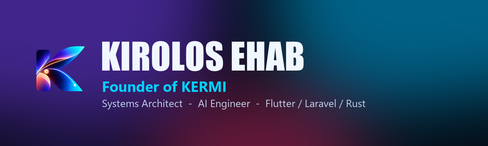
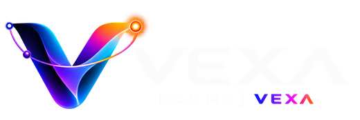
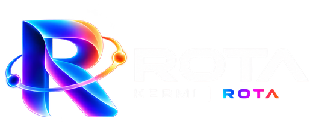
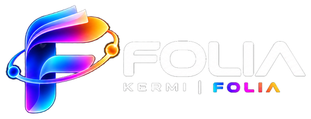
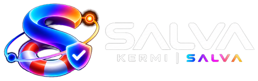
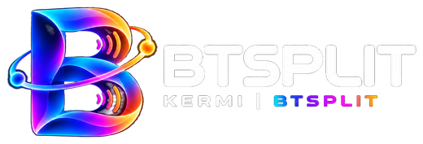
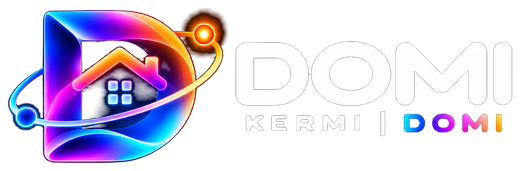

  
  
  
  

## Hi, I'm Kirolos

I build **apps, websites and the systems behind them**: a Flutter food-delivery suite, Windows desktop tools, Android launchers for smart projectors, Laravel back-ends and SEO-driven publishing platforms. Based in Egypt (GMT+2), working with teams in Saudi Arabia, the UAE and the UK.

- **Founder of [KERMI](https://kermi.one)**, an independent software brand with **8 apps** for Windows and Android
- **CTO, The Saudi Times**: grew its Semrush Authority Score from **8 to 40**
- **Lead developer, Meat Station**: customer, driver, restaurant and admin apps on Android and iOS, plus POS and a Laravel back-end
- Custom **AI agents** and automation pipelines (WhatsApp, Telegram, dashboards)
- Looking for a long-term role with a major Egyptian company, open to remote collaboration too

## KERMI: the product line

  &nbsp;&nbsp;
  &nbsp;&nbsp;
  &nbsp;&nbsp;
    
  &nbsp;&nbsp;
  &nbsp;&nbsp;
  &nbsp;&nbsp;
  

| App | What it does | Platform |
|---|---|---|
| **Vexa** | Image to clean editable vectors, background removal, AI upscaling, seamless patterns | Windows |
| **Rota** | Drag a file, hold Shift: convert or edit images, PDF, Office, audio and video offline | Windows |
| **Folia** | PDF editor that keeps font, size and colour, with correctly joined Arabic | Windows |
| **Salva** | Read-only flash and disk repair and recovery; every fix backed up and undoable | Windows |
| **Lino** | Screenshots on a glass line at the top of the screen: drag, mark up, OCR | Windows |
| **BTSplit** | One PC sound on several Bluetooth speakers, in sync | Windows |
| **Kermi Lumo** | Fast, ad-free Google-TV-style launcher for projectors and TV boxes | Android TV |
| **Kermi Domi** | Old tablet turned into a wall-mounted Home Assistant smart-home panel | Android |

## Toolbox

## What I'm good at

- **Apps**: build, ship, measure, optimize. Caching layers, image pipelines, session bugs, stuck states
- **Websites**: technical SEO, structured data, Cloudflare, crawler-traffic forensics
- **Big data**: auditing and repairing thousands of records, bulk rewrites with backup and rollback
- **Device UI**: replacing slow stock launchers on projectors and tablets with custom interfaces

## Featured

- [**kyrolosehab.me**](https://kyrolosehab.me): my interactive portfolio, with a live Capability Lab
- [**kermi.one**](https://kermi.one): apps, demos and guides in English and Arabic
- [Kyrolos-Ehab](https://github.com/Eng-Kirolos-Ehab/Kyrolos-Ehab): the portfolio source

Open to the right opportunity: kyrolosehab@gmail.com

