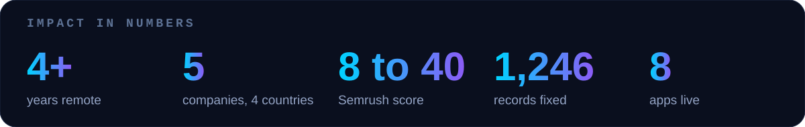
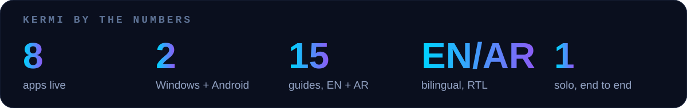

  
  
  
  

## About me

I'm a **systems architect and AI engineer** from Egypt. For 4+ years I've run the technology side of companies in Saudi Arabia, the UAE, the UK and Egypt, often several at once: choosing the architecture, building it, shipping it and keeping it healthy. My range goes from **Flutter apps and Laravel back-ends** to **technical SEO, AI agents, Shopify commerce and big-data cleanup**, and I also build my own products under [KERMI](https://kermi.one).

I'm looking for a **long-term role at a major Egyptian company** (on-site or hybrid), and I'm open to remote collaboration.

## Experience

| Where | Role | What I did |
|---|---|---|
| **The Saudi Times** (KSA) | CTO, 2024 to now | Grew the Semrush Authority Score from **8 to 40**, owned platform architecture, performance and security, built AI content pipelines, media kit, magazine and sponsorship templates |
| **Meat Station** (KSA) | Lead developer, 2025 to now | Flutter suite (customer, driver, restaurant, admin) on Android and iOS, Laravel back-end, POS with counter mode, KPI dashboards, Shopify storefront |
| **Feraasa** (UAE) | Web developer and AI lead, 2024 to now | Bilingual Laravel platform, AI image analysis and chatbot, live security-incident response, automated email and service flows |
| **Publishelly** (UAE) | Web developer, 2024 to now | WordPress launch with advanced on-page SEO, press-release and media-kit features, analytics and lead tracking |
| **Oloom** (UK) | IT manager, 2023 to 2024 | Infrastructure and website for an educational SaaS, integrations across email, analytics and automation |
| **KERMI** | Founder, 2026 to now | Eight Windows and Android apps, licensing, admin back-office, in-app updates, bilingual site |
| **Ezz Steel** (Egypt) | Engineering trainee, 2022 to 2023 | PLC control and monitoring systems, electrical distribution |

Education: **B.Sc. Computer and Systems Engineering**, Badr University in Cairo, 2024 (GPA 3.39 / 4.0).

## Selected work

<table>
<tr>
<td width="50%" valign="top">

**Apps: build, ship, optimize**
- Meat Station Flutter apps live on Android and iOS
- Fixed slow lists with a disk image cache and right-sized decoding
- Added a cache-then-network layer so screens open instantly and work offline
- Traced random logouts to a single shared auth token and fixed the session model
- Removed endless loaders across 14 screens with one pattern fix

</td>
<td width="50%" valign="top">

**Websites: SEO and reliability**
- Semrush Authority Score **8 to 40** for The Saudi Times
- Audited a live-scores plugin: 473K cache files and about 89% crawler traffic traced to the cause
- Structured data, sitemaps, Cloudflare rules and hreflang done properly
- Handled real hacking attempts on a production platform and hardened access

</td>
</tr>
<tr>
<td width="50%" valign="top">

**Big data: audit, fix, organize**
- Audited and repaired **1,246** menu items across 29 restaurants
- Rewrote **1,206** Arabic names and descriptions with backup and rollback
- Deduplicated CRM imports against a live database by phone number
- Scripted bulk operations that never silently drop fields

</td>
<td width="50%" valign="top">

**AI and automation**
- Custom agents on OpenAI, Gemini and Claude wired into WhatsApp, Telegram and dashboards
- Editorial pipelines that cut manual publishing work
- Image-analysis chatbot for a personality platform
- Job-triage assistant that tailors an ATS CV to each posting

</td>
</tr>
<tr>
<td width="50%" valign="top">

**Commerce and operations**
- Shopify storefront with custom sections and dynamic widgets
- POS system with take-away and counter mode, low-stock reports
- Payments flow moved from order placement to acceptance, with a rollback plan
- Real-time KPI dashboards for sales and operations

</td>
<td width="50%" valign="top">

**Devices and desktop**
- Custom Android launchers for a projector and an old tablet
- Windows apps in Rust and Python: PDF editing with proper Arabic, disk repair, multi-speaker audio
- Home Assistant dashboards controlling a real home

</td>
</tr>
</table>

## KERMI, my own product line

  &nbsp;
  &nbsp;
  &nbsp;
  &nbsp;
  &nbsp;
  &nbsp;
  &nbsp;
  

<b>What each app does</b>

| App | What it does | Platform |
|---|---|---|
| **Vexa** | Image to clean editable vectors, background removal, AI upscaling, seamless patterns | Windows |
| **Rota** | Drag a file, hold Shift: convert or edit images, PDF, Office, audio and video offline | Windows |
| **Folia** | PDF editor that keeps font, size and colour, with correctly joined Arabic | Windows |
| **Salva** | Read-only flash and disk repair and recovery; every fix backed up and undoable | Windows |
| **Lino** | Screenshots on a glass line at the top of the screen: drag, mark up, OCR | Windows |
| **BTSplit** | One PC sound on several Bluetooth speakers, in sync | Windows |
| **Kermi Lumo** | Fast, ad-free Google-TV-style launcher for projectors and TV boxes | Android TV |
| **Kermi Domi** | Old tablet turned into a wall-mounted Home Assistant smart-home panel | Android |

## Toolbox

## Contribution snake

  <picture>
    <source media="(prefers-color-scheme: dark)" srcset="https://raw.githubusercontent.com/Eng-Kirolos-Ehab/Eng-Kirolos-Ehab/output/github-snake-dark.svg">
    
  </picture>

## Featured

- [**kyrolosehab.me**](https://kyrolosehab.me): my interactive portfolio with a live Capability Lab (apps, websites, big data, languages, device UI)
- [**kermi.one**](https://kermi.one): apps, demos and guides in English and Arabic
- [Kyrolos-Ehab](https://github.com/Eng-Kirolos-Ehab/Kyrolos-Ehab): the portfolio source
- [AI attendance system](https://github.com/Eng-Kirolos-Ehab/AI-powered-attendance-with-facial-recognition): face, voice and emotion recognition project
- [Smart irrigation system](https://github.com/Eng-Kirolos-Ehab/Smart-Irrigation-System): STM32 embedded control

Open to the right opportunity · kyrolosehab@gmail.com

